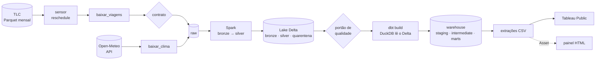
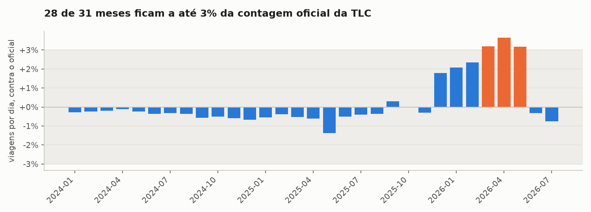
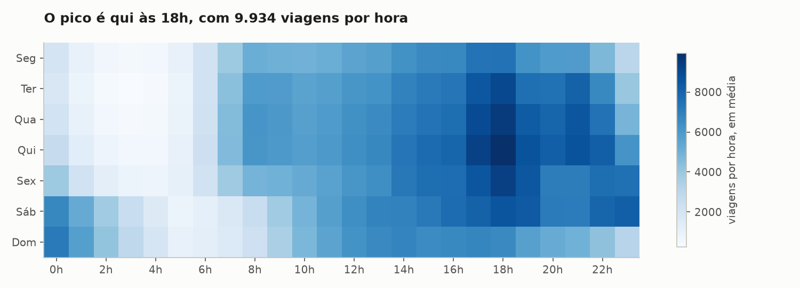
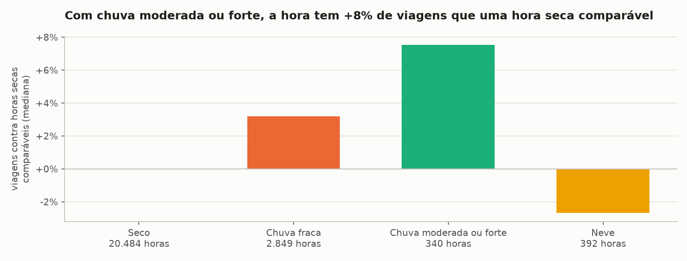
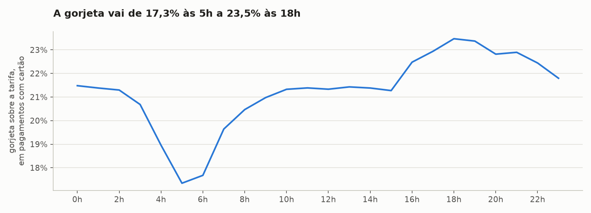
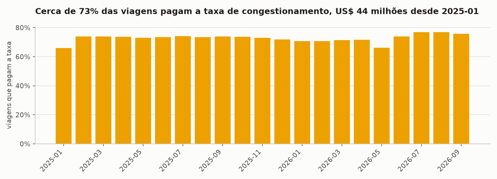

# Plataforma de dados: táxis de Nova York

[](https://github.com/devglucas/NYC-Taxi-Data-Platform/actions/workflows/ci.yml)

Plataforma de ponta a ponta sobre **dados reais**: 33 meses de viagens de táxi amarelo de Nova
York, de janeiro de 2024 a setembro de 2026, com 123,5 milhões de linhas, cruzados com o clima
de cada hora. É o projeto final da coleção e junta as peças dos anteriores:

**ingestão → lake Delta com Spark → warehouse com dbt → orquestração com Airflow → painel e
Tableau, com CI no GitHub Actions.**

## O problema

Uma operadora de frota, ou a própria prefeitura, quer saber quando e onde há demanda, se o clima
muda esse padrão, quanto pesa a nova taxa de congestionamento e se os números merecem confiança.
As respostas dependem de três fontes que chegam em ritmos diferentes, de arquivos que mudam de
formato entre os anos e de um volume que não cabe confortavelmente em uma planilha.

## Fontes

| Fonte | Formato | Uso |
|---|---|---|
| [Registros de viagem da TLC](https://www.nyc.gov/site/tlc/about/tlc-trip-record-data.page) | Parquet mensal, cerca de 60 MB por mês | Viagens |
| [API histórica da Open-Meteo](https://open-meteo.com/en/docs/historical-weather-api) | JSON por hora, para Central Park | Clima: temperatura, chuva e neve |
| Zonas de táxi da TLC | CSV | Nomes e distritos das 265 zonas |
| [Relatório mensal da TLC](https://www.nyc.gov/assets/tlc/downloads/csv/data_reports_monthly.csv) | CSV | Gabarito: viagens por dia publicadas pela própria TLC |

Os dados brutos não ficam no repositório. A TLC diz que os registros vêm dos fornecedores de
tecnologia e não garante sua exatidão, e os termos do NYC.gov reservam os direitos do conteúdo.
Os dados de clima são da Open-Meteo, sob a licença CC BY 4.0, gerados a partir de informações do
Copernicus Climate Change Service. O repositório guarda só código e agregados.

## Arquitetura



| Camada | Tecnologia | Conteúdo |
|---|---|---|
| raw | arquivos | Parquet da TLC, JSON do clima, CSVs de referência, com SHA-256 e ETag em `dados/controle` |
| bronze | Delta, Spark | O arquivo do mês com nomes e tipos padronizados, mais origem e horário de ingestão |
| silver | Delta, Spark | Viagens válidas com campos derivados, quarentena com motivo e clima por hora local |
| warehouse | DuckDB, dbt | 5 views de staging, 1 tabela intermediária incremental e 9 marts |
| consumo | CSV e HTML | 7 extrações para o Tableau e um painel gerado a cada atualização |

O DuckDB lê as tabelas Delta no lugar, pela extensão `delta`, declaradas como *sources* do dbt.
Não há cópia do lake para o banco.

### Decisões

| Situação | Decisão |
|---|---|
| A TLC publica com cerca de dois meses de atraso, sem data | Sensor em `reschedule`, consultando a cada 6 h, como no projeto 10 |
| Spark e Airflow na mesma máquina | Spark em modo local dentro da tarefa, com o pool `spark` de 1 vaga para caber na memória do Docker |
| dbt e Airflow têm dependências conflitantes | dbt em um ambiente virtual próprio dentro da imagem |
| DuckDB aceita um único processo escritor | Pool `warehouse` de 1 vaga para o dbt, as extrações e o painel |
| Reprocessar um mês | `replaceWhere` no Delta e `delete+insert` por mês nos incrementais do dbt |
| Horário das viagens é local e sem fuso; o clima vem em UTC | Sessão Spark em UTC, para não converter nada, e clima convertido para o horário de Nova York; na volta do horário de verão, as duas medições da 1h viram uma |
| Os marts mudam | O Asset `plataforma_marts` dispara a DAG do painel |

## Regras de qualidade

As regras da silver são as do [projeto 10](https://github.com/devglucas/NYC-Taxi-Airflow-Pipeline),
reescritas em Spark: estornos, corridas enviadas duas vezes, viagens fora do mês, durações acima
de 24 h, distâncias e valores impossíveis, e zonas inválidas vão para a quarentena com o motivo.
As viagens do fornecedor 7, que grava duração zero, ficam marcadas e saem só das médias de duração.

| Onde | Verificação |
|---|---|
| Portão do Airflow, crítica | Bruto = silver + quarentena; silver não vazia; nada fora do mês; quarentena até 10%; clima com 671 horas ou mais |
| Portão do Airflow, alerta | Colunas novas na fonte |
| dbt, 24 testes de dados | Chaves únicas e não nulas, combinações únicas, relacionamentos com `dim_zona`, valores aceitos, conservação de viagens e receita entre silver e marts, horas com viagem sem clima |
| dbt, 3 testes unitários | Classificação do tempo, índice de demanda contra horas secas e estados da conciliação |
| dbt, contratos | `fct_demanda_clima` e `fct_zonas_mes`, as tabelas que o Tableau consome |
| dbt, alerta | Conciliação com o relatório oficial fora de ±3% |

## Resultados

### A carga real

O backfill dos 33 meses rodou no Airflow em 55 minutos, sem nenhuma nova tentativa e sem nenhum
alerta. O histórico de cada tarefa está em [`output/evidencias/tarefas.csv`](output/evidencias/tarefas.csv).

| Etapa | Tempo médio por mês | Maior tempo |
|---|---|---|
| Spark: bronze e silver | 97 s | 197 s |
| dbt build com 42 nós | 9 s | 22 s |
| Download das viagens | 8,5 s | 14,6 s |

Sobre o volume:

- **Linhas:** 123.471.721 brutas, 121.644.404 viagens válidas e 1,48% em quarentena.
- **Espaço:** o lake ocupa 6,5 GB e o warehouse, 394 MB.
- **Reprocessamento:** refazer um mês sem mudança no arquivo pula o download pelo ETag e deixa os
  totais idênticos.

### Três implementações, o mesmo número

| Comparação | Resultado |
|---|---|
| Spark contra o DuckDB do projeto 10, nos 33 meses | Linhas brutas, viagens, cada motivo de quarentena, durações inválidas e somas divergentes **idênticos** |
| Warehouse construído mês a mês pelo Airflow contra um full refresh separado | **0 linhas diferentes** em 10 tabelas, com 7,7 milhões de linhas na maior |
| Pipeline contra o relatório oficial da TLC | 28 de 31 meses a até 3%; de março a maio de 2026 ficam 3,2% a 3,7% acima, a mesma divergência do projeto 10, ainda sem causa conhecida |



### Demanda



O pico é às 18h de quinta-feira, com média de 9.934 viagens por hora. No fim de semana, a
madrugada pesa: no domingo, a hora de 0h tem 7.171 viagens em média, mais que a das 14h, com 6.780.

### Clima



Cada hora é comparada com a mediana das horas **secas** com o mesmo dia da semana e o mesmo
horário, no mesmo mês. Com chuva moderada ou forte, a hora tem 7,5% mais viagens, e 8,7% mais em
dias úteis, das 7h às 19h. Com chuva fraca, são 3,2% mais. Com neve, 2,7% menos. A gorjeta quase
não muda: 21,8% da tarifa em horas secas e 22,3% com chuva forte.

É uma associação, não um efeito medido: chuva forte é rara, com 343 horas em 33 meses, e pode
coincidir com outros fatores.

### Gorjeta



### Taxa de congestionamento



Desde que a taxa da zona central de Manhattan começou, em janeiro de 2025, cerca de 73% das
viagens a pagam, somando US$ 44,2 milhões até setembro de 2026.

## Dashboard

- **Painel HTML:** [`output/painel/index.html`](output/painel/index.html) é gerado pela DAG
  `plataforma_painel` a cada atualização dos marts. É um arquivo só, que abre em qualquer
  navegador.
- **Tableau Public:** as extrações estão em [`output/tableau/`](output/tableau/), e a
  especificação completa, com perguntas, campos calculados, folhas, dashboards e publicação, em
  [`tableau/ESPECIFICACAO.md`](tableau/ESPECIFICACAO.md). *Link do dashboard publicado: a
  adicionar.*

## CI

O workflow [`ci.yml`](.github/workflows/ci.yml) roda a cada push:

1. **Pipeline:** `ruff`, os testes de unidade e de Spark e a plataforma de ponta a ponta sobre
   uma amostra sintética gerada por [`scripts/gerar_amostra.py`](scripts/gerar_amostra.py). A
   amostra inclui de propósito um estorno, uma corrida em duplicidade, uma viagem fora do mês e
   viagens com duração zero. O passo constrói o lake, roda o `dbt build` com todos os testes e
   confere que o incremental de um mês é igual ao full refresh.
2. **DAGs:** instala o Airflow 3.4 com as restrições oficiais e testa a integridade das DAGs.

## Estrutura

```
11-nyc-taxi-platform/
├── dags/                     # plataforma_mensal e plataforma_painel
├── src/
│   ├── fonte.py  clima.py  contrato.py   # ingestão
│   ├── lake/                             # sessão Spark, esquema, bronze e silver
│   ├── pipeline.py                       # etapas chamadas pelo Airflow e pelo main.py
│   ├── qualidade.py  alertas.py  controle.py
│   └── exportar.py  painel.py            # extrações e painel
├── dbt/                      # sources Delta, staging, intermediate, marts, testes e macros
├── tableau/ESPECIFICACAO.md  # guia do dashboard
├── scripts/                  # amostra do CI e comparações
├── tests/                    # 35 testes, incluindo Spark e DAGs
├── output/                   # painel, gráficos, extrações e evidências
├── main.py                   # roda sem Airflow
└── Dockerfile  docker-compose.yml  .github/workflows/ci.yml
```

## Tecnologias

Apache Airflow 3.4, Spark 4.2 com Delta Lake 4.4, dbt-core 1.12 com dbt-duckdb, DuckDB 2.0,
Python 3.14, Docker Compose, GitHub Actions, ruff, pytest, matplotlib e Tableau Public.

## Como rodar

Requer Docker com ao menos 6 GB de memória.

```bash
cp .env.example .env
docker compose up -d --build
```

O Airflow fica em http://localhost:8086, com usuário e senha `airflow`, apenas para uso local.

```bash
# um mês
docker compose exec airflow-scheduler airflow dags unpause plataforma_mensal
docker compose exec airflow-scheduler airflow dags unpause plataforma_painel
docker compose exec airflow-scheduler airflow dags trigger plataforma_mensal --conf '{"mes": "2026-09"}'

# os 33 meses: cerca de 2,1 GB de download e uma hora de processamento
docker compose exec airflow-scheduler airflow backfill create --dag-id plataforma_mensal \
  --from-date 2024-01-01 --to-date 2026-09-30 --max-active-runs 3
```

Sem Airflow, com Python 3.14 e Java 17 ou 21:

```bash
pip install -r requirements.txt
python main.py 2026-08 2026-09
scripts/dbt_local.sh build --full-refresh
```

Testes:

```bash
pytest -q                                                     # fora do contêiner; os testes de DAG são pulados
docker compose exec airflow-scheduler python -m pytest -q tests   # todos
```

## Problemas encontrados

- **Imagem do Airflow sem trust store:** a imagem oficial do Airflow 3.4 usa uma base Debian
  endurecida, e o pacote `ca-certificates-java` não consegue gerar o trust store do Java nela.
  Sem ele, o Spark não baixa os jars do Delta. O Dockerfile monta o trust store a partir do
  pacote PEM do sistema.
- **Modelo de rotas sem memória:** a primeira versão calculava a mediana de todos os pares de
  zonas e estourava a memória no full refresh, mesmo com 8 GB. Agora escolhe as 300 rotas do mês
  antes e calcula as medianas só para elas; o full refresh roda em 22 s com 4 GB e dá o mesmo
  resultado.
- **Inteiros no JSON:** a API de clima pode devolver `0` em vez de `0.0`, e o Spark recusava o
  valor no esquema `double`. A amostra do CI revelou o problema antes da carga real.

## Limitações

- **Dashboard no Tableau:** ainda não foi publicado, porque a conta tem de ser criada por você.
- **Divergência em aberto:** de março a maio de 2026, a contagem fica 3,2% a 3,7% acima da
  oficial, sem explicação.
- **Uma estação de clima:** o clima é o de Central Park para a cidade toda.
- **Spark em modo local:** em um cluster, o mesmo código rodaria sem mudança, mas isso não foi
  testado aqui.
- **Alertas:** os alertas ficam em arquivo; o envio para webhook foi escrito, mas nunca testado
  com um serviço real.
